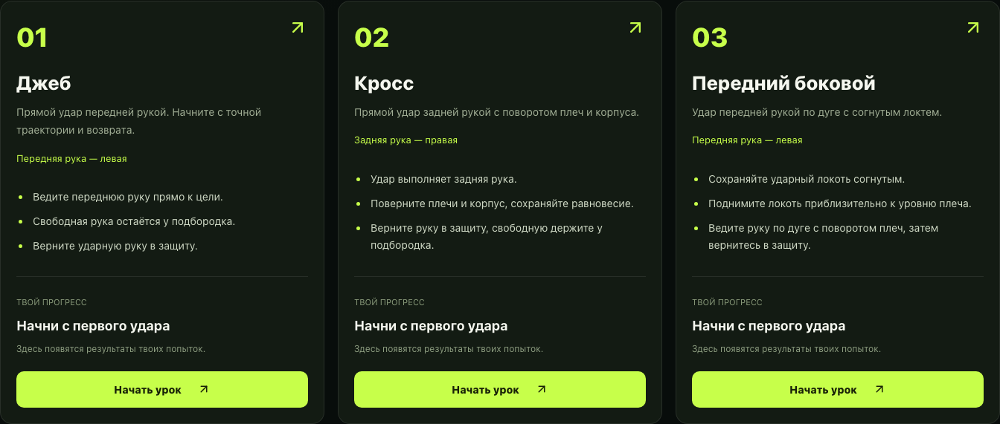

# ShadowCoach

Browser-based boxing practice with on-device pose estimation, deterministic
technique checks, and optional AI explanations.

**[Open the verified web demo](https://shadow-fight-unified.vercel.app/)**



Admit Hackathon 2026 · Motion · B / FITNESS · team NAN. The project received
**87/100** from the hackathon jury and did not enter the final top 15.

## Problem

A recorded lesson explains a movement but cannot react to one learner's punch.
ShadowCoach combines a short lesson, a camera-based practice flow, and feedback
on one selected punch. The user chooses jab, cross, or lead hook; the system
does not claim to classify arbitrary boxing movements.

## Approach

1. MediaPipe Pose Landmarker runs in a Web Worker and produces body landmarks.
2. A state machine confirms guard calibration and isolates one punch attempt.
3. `coach-core` normalizes coordinates and calculates motion, elbow, guard,
   trajectory, and return features.
4. Explicit TypeScript rules determine data quality, violations, and the local
   score. MediaPipe does not provide the boxing score.
5. An optional NVIDIA NIM request explains the already selected feedback. It
   does not replace the local evaluator and receives no video or raw landmarks.

The core practice flow works without an account, FastAPI, or an NVIDIA key.

## Results

### Labelled video evaluation

The fixed evaluation contains **100 clips** from 20 source videos of one
participant: 35 jabs, 30 crosses, and 35 lead hooks. The exercise type and
stance were provided to the system. Expert labels cover 12 technique checks;
undefined and non-applicable labels were excluded from the metric.

The full path—pose landmarks, guard calibration, attempt capture, and
rule-based evaluation—reached **51.9% micro-F1** for error detection when missed
attempts were included. A completed score was produced for **55/100 clips**;
this is score coverage, not accuracy.

| Exercise | Completed scores | Precision | Recall | F1 |
| --- | ---: | ---: | ---: | ---: |
| Jab | 23/35 | 46.9% | 57.7% | 51.7% |
| Cross | 21/30 | 73.7% | 70.0% | 71.8% |
| Lead hook | 11/35 | 33.3% | 26.3% | 29.4% |
| **All clips** | **55/100** | **51.5%** | **52.3%** | **51.9%** |

A diagnostic shortcut that analysed each whole clip completed 92 scores but
reached only **26.6% micro-F1**. Higher coverage alone did not improve quality.
The dataset is small, comes from one participant, and was used during
development, so these results are not an independent generalization claim.
They also do not validate the meaning of the 0–100 technique score.

### Reproducibility checks

The current local verification completed **241/241 runnable Node tests** with
20 private-data tests explicitly skipped. TypeScript passed, and **108/108**
synthetic cases matched the Python reference within `1e-7`. The production
build additionally needs the git-ignored MediaPipe model file; see the setup
commands below.

No physical-camera FPS or end-to-end latency benchmark is claimed.

## How to run

Requirements: Node.js 22.12 or newer and npm.

```bash
git clone https://github.com/alikhrzh/Shadow-Fight.git
cd Shadow-Fight
npm ci
npm run model:download
npm run dev
```

Open the local URL printed by Vite. Camera access requires `localhost` or HTTPS.
For the optional FastAPI/PostgreSQL account and history service:

```bash
cd backend
docker compose up --build -d
curl --fail http://127.0.0.1:8000/health/ready
```

Run the main checks from the repository root:

```bash
npm test
npm run test:parity
npm run typecheck
npm run build
```

Browser tests and backend tests are documented in
[`docs/TESTING.md`](docs/TESTING.md) and [`backend/README.md`](backend/README.md).
Deployment details are in [`docs/DEPLOYMENT.md`](docs/DEPLOYMENT.md).

## Project structure

```text
apps/web/                 React/Vite interface and camera flow
packages/coach-core/      Features, quality gates, and scoring rules
shared/                   Shared configuration and contracts
api/coach-feedback.ts     Optional NVIDIA explanation endpoint
backend/                  FastAPI, PostgreSQL, and migrations
tests/, browser-tests/    Unit, parity, and browser checks
tools/python-reference/   Python reference implementation
docs/                     Architecture, testing, and deployment notes
```

The live training path is deliberately split into layers:

- `apps/web/` owns the React interface, camera lifecycle, MediaPipe worker,
  gestures, attempt state machine, local progress, and feedback presentation.
- `packages/coach-core/` contains framework-independent feature extraction,
  quality gates, technique rules, and scoring.
- `shared/` stores configuration and contracts used by the browser, tests, and
  reference implementation so thresholds do not drift between components.
- `api/coach-feedback.ts` is the optional server-side NVIDIA explanation
  endpoint; it receives allowlisted aggregates rather than video or landmarks.
- `backend/` provides the optional account, history, and progress API with
  FastAPI, PostgreSQL, and Alembic migrations.
- `tests/` exercises deterministic TypeScript logic, `browser-tests/` covers
  user flows, and `tools/python-reference/` checks numerical parity.
- `scripts/` contains model download, build audit, replay, and parity utilities;
  `docs/` explains architecture, testing boundaries, and deployment.

## Privacy and model disclosure

- Camera frames and landmarks are processed in the browser and are not uploaded.
- The application does not request the microphone or record video.
- Guest progress stores aggregate results in local storage.
- The optional AI payload is allowlisted and contains aggregate features, not
  frames, joint coordinates, or account data.
- MediaPipe Pose Landmarker and the optional NVIDIA language model are
  pretrained models; the team did not train them.
- AI assistants supported parts of implementation and documentation review.
  The repository authors remain responsible for the rules, tests, claims, and
  final product decisions.

## Limitations

- The labelled set contains one participant and is not an independent benchmark.
- Lead-hook capture and feedback are substantially weaker than cross results.
- The project has not published measurements from physical Android/iPhone
  cameras or Safari, including FPS, latency, heat, and battery use.
- A 2D camera angle can distort elbow and shoulder measurements.
- Rules cover three selected exercises, not combinations or open-ended action
  recognition.
- AI explanations may be unavailable or wrong; local feedback remains visible.

## Roadmap

- Evaluate on new participants and camera positions held out from development.
- Improve lead-hook attempt capture before tuning technique thresholds.
- Add a physical-device matrix with FPS, latency, heat, and failure-rate results.
- Review technique labels and feedback with a qualified boxing coach.
- Calibrate the 0–100 score against labelled outcomes before presenting it as a
  meaningful quality measure.
- Expand exercises only after the current three meet an explicit quality bar.
