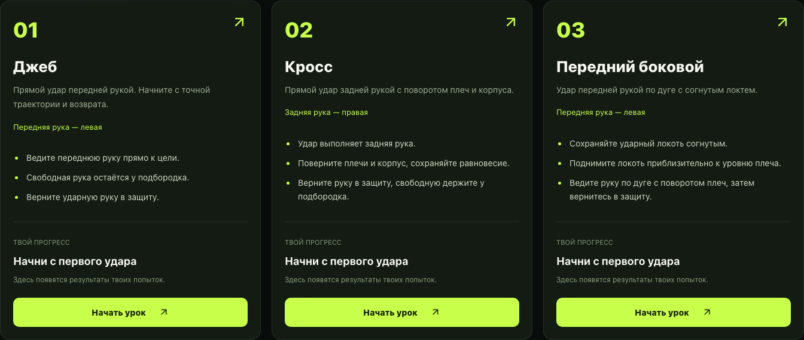
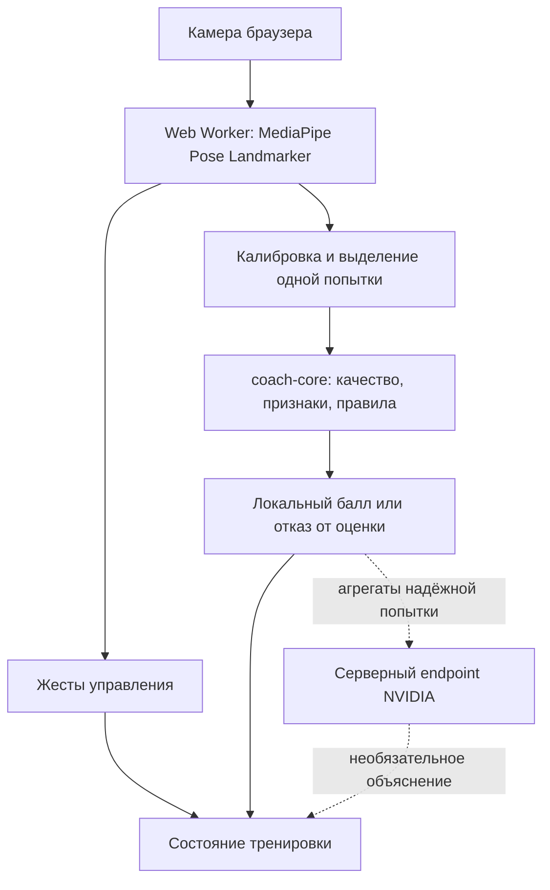

# ShadowCoach

**Камера — контроллер. Один удар — конкретная обратная связь.**

ShadowCoach — браузерный учебный тренажёр по боксу. Пользователь выбирает стойку и удар, смотрит урок, запускает попытку жестом и получает локальный разбор движения. [Открыть приложение](https://shadow-fight-unified.vercel.app/).



Admit Hackathon 2026 · Motion · B / FITNESS · команда NAN. Оценка жюри — **87/100**; проект не вошёл в финальный топ-15. Базовая тренировка работает без аккаунта, FastAPI и ключа NVIDIA.

## Что делает приложение

1. Выберите стойку и один из трёх ударов: джеб передней рукой, кросс задней или передний боковой (хук).
2. Посмотрите урок и перейдите к практике. Браузер запросит камеру, но не микрофон.
3. Поднимите обе руки примерно на секунду для запуска. После отсчёта встаньте в защиту и ненадолго замрите для калибровки.
4. Выполните один удар и верните руку в защиту. Система пытается отделить эту попытку от подготовки и остальных движений.
5. Если данных достаточно, увидите балл, измеренные компоненты и замечания. Если данных не хватает, увидите причину отказа без выдуманного балла. Повтор доступен жестом или кнопкой.

Выбранный тип упражнения известен заранее: приложение **не распознаёт произвольные виды ударов**. Показ скелета сам по себе также не означает, что техника удара измерена достаточно надёжно.

## Как получается результат



**Готовая модель MediaPipe** выдаёт координаты ключевых точек тела. Команда не обучала эту модель. [Камера](apps/web/src/components/LiveCamera.tsx) отправляет кадры в [worker](apps/web/src/pose/pose.worker.ts): пока предыдущий кадр обрабатывается, очередь новых кадров не накапливается. Worker вызывает модель и передаёт точки в контроллер попытки.

**Логика приложения** проверяет жесты, ведёт состояния тренировки, калибрует защиту и выделяет один удар. [Анализатор](packages/coach-core/src/analyze.ts) проверяет пригодность данных; [вычисление признаков](packages/coach-core/src/features.ts) измеряет движение кисти, угол локтя, траекторию, положение свободной руки и возврат; [правила](packages/coach-core/src/evaluate.ts) сопоставляют признаки с [порогами и весами](shared/config/defaults.json). Это правила в TypeScript, а не нейросеть, обученная определять ошибки техники.

**NVIDIA** при доступности получает ограниченные агрегаты и может текстом объяснить уже выбранное локальное замечание. Она не устанавливает числовой балл. При отсутствии ключа или ошибке запроса локальный результат остаётся доступен. Состав отправляемых данных ограничен [safePayload](apps/web/src/feedback/safePayload.ts).

### Жест управления ≠ измеримая техника

Поднятые руки могут быть достаточно различимы для команды «начать», даже если человек слишком далеко для оценки удара. Поэтому [условия для жеста и для оценки](apps/web/src/training/cameraQuality.ts) разделены. [Тест этого случая](tests/gesture-camera.test.ts) проверяет оба условия на искусственном кадре и удержание жеста; он не проверяет физическую камеру и точность оценки бокса.

### Ошибка движения ≠ плохие данные

`guard_dropped`, `low_amplitude` и `insufficient_extension` — примеры замечаний о технике после завершённой оценки. `wrist_not_visible`, `multiple_people` и `low_pose_quality` означают, что исходным точкам нельзя доверять достаточно для балла. Ненадёжная попытка не должна попадать в среднюю оценку или запрос на AI-объяснение.

## Три случая из разработки

### 1. Поднятые руки не запускали тренировку

**Симптом.** Человек поднимает руки, но команда начала или повтора не срабатывает, хотя кисти и голова различимы.

**Причина и изменение.** Для управляющего жеста применялась строгая проверка кадра, нужная для оценки удара. В ней горизонтальная ширина плеч должна быть не меньше `0.12` доли ширины изображения; видимый человек на расстоянии мог не пройти этот порог. Теперь [gestureCameraQuality](apps/web/src/training/cameraQuality.ts) отдельно проверяет одного человека, свет, частоту обработки, видимость головы и рук и пригодность масштаба для жеста. Строгая [cameraQuality](apps/web/src/training/cameraQuality.ts) для техники сохранена. Это разные проверки, а не замена порога `0.12` на другое число. Жест по-прежнему нужно удерживать `950 мс` в [проверяемом сценарии](tests/gesture-camera.test.ts).

**Доказательство и предел.** [Тест](tests/gesture-camera.test.ts) создаёт небольшой силуэт с поднятыми руками: строгая проверка просит подойти ближе, проверка жеста пропускает кадр, распознаватель видит жест и удержание даёт ровно одно событие. По [историческому отчёту](docs/TESTING.md), на тех же сохранённых кадрах после комплекса исправлений старта и повтора результат изменился с **0/12 до 12/12** отдельно для каждого проверенного состояния. Это повторная проверка записанных кадров, а не 36 независимых людей и не доказательство работы на любой живой камере.

### 2. Опускание руки принималось за джеб

**Симптом.** При выходе из защиты опускание кисти могло быть принято за начало удара; в окно оценки попадало лишнее движение.

**Причина и изменение.** Одних скорости и удаления кисти от исходной позиции недостаточно: рука может быстро уйти вниз. В [PunchCapture](apps/web/src/training/punchCapture.ts) добавлена проверка преимущественного движения вниз (`dy > min_start_displacement` и `dy > |dx|`), а также отдельное подтверждение удара, отсеивание подготовки и ограничение выбора пика. Захват отвечает на вопрос «где попытка?», а [оценщик](packages/coach-core/src/evaluate.ts) — «какие ошибки техники видны в этой попытке?».

**Доказательство и предел.** [Отчёт о проверке джеба](docs/JAB-CAPTURE.md) фиксирует **14/14** сопоставленных пиков намеренных джебов с ручными интервалами и **13/14** подтверждённых возвратов. На трёх отрицательных записях (`handup`, `handcross`, `freemotions`) лишних выходов захвата не было. При этом только **3/14** попыток получили оценку: найденное движение ещё не означает, что точки достаточно надёжны для балла. Это результаты описанного в документации прогона на конкретных записях, а не мой новый запуск тестов.

### 3. Поздний удар обрывался таймером ожидания

**Симптом.** Если движение начинается почти в конце восьмисекундного ожидания, старый таймер мог закончиться до завершения удара.

**Изменение.** [captureWaitRemaining](apps/web/src/training/captureDeadline.ts) оставляет исходные **8000 мс** на начало, но после начала движения выбирает более поздний срок: `max(начало ожидания + 8000, начало движения + max_attempt_duration_ms + 700)`. Если движения нет, дополнительное время не выдаётся.

**Проверка и предел.** В [тесте](tests/capture-deadline.test.ts) ожидание начинается в `1000 мс`, движение — в `8900 мс`. Старый срок — `9000 мс`; новый — `11400 мс`, поэтому в момент `9000 мс` остаётся `2400 мс`. Тест проверяет арифметику срока, но не подтверждает улучшение на реальном видео.

## Результаты на размеченных видео

Для анализа использовались **100 клипов из 20 исходных видео одного участника**: 35 джебов, 30 кроссов и 35 передних боковых. Тип удара и стойка задавались системе. Экспертная разметка охватывала 12 проверок ошибок; неопределённые и неприменимые метки исключались из расчёта.

| Удар | Клипов | С завершённой оценкой | Precision | Recall с учётом пропусков | Micro-F1 |
| --- | ---: | ---: | ---: | ---: | ---: |
| Джеб | 35 | 23/35 | 46,9% | 57,7% | 51,7% |
| Кросс | 30 | 21/30 | 73,7% | 70,0% | 71,8% |
| Передний боковой | 35 | 11/35 | 33,3% | 26,3% | 29,4% |
| **Всего** | **100** | **55/100** | **51,5%** | **52,3%** | **51,9%** |

**55/100 — покрытие оценкой**, то есть доля клипов, для которых получилось выдать завершённый отчёт. Это не «точность 55%». **51,9% micro-F1** — качество обнаружения размеченных ошибок с учётом пропущенных попыток. По данным зафиксированного прогона: 34 верных замечания, 32 ложных и 31 пропущенная ошибка. Поэтому precision = 34/66, recall = 34/65, F1 = 68/131 ≈ 51,9%.

Для диагностики весь клип также анализировали напрямую, минуя контроллер одной попытки. Такой путь выдал 92 оценки, но получил лишь **26,6% micro-F1**. Дополнительные отчёты не сделали замечания точнее: при анализе всего клипа подготовка и другие движения могут смешиваться с оцениваемым ударом. Это объяснение возможного механизма, а не отдельно доказанная причина каждого промаха.

Данные одного человека использовались при разработке. Они не подтверждают качество на новых людях, камерах и ракурсах, а также не подтверждают, что балл 0–100 соответствует экспертной оценке техники. Особенно слабым остаётся передний боковой. Следующая проверка — записать новых участников и ракурсы, не менять пороги на этих записях, разметить ошибки независимо и отдельно посчитать покрытие, precision, recall и F1 по каждому удару.

## Быстрый запуск

Нужны Git, npm и Node.js **22.12 или новее**. Из корня проекта:

```bash
git clone https://github.com/alikhrzh/Shadow-Fight.git
cd Shadow-Fight
npm ci
npm run model:download
npm run dev
```

Откройте адрес, напечатанный Vite. Камера работает через `localhost` или HTTPS. `model:download` загружает файл MediaPipe, которого нет в Git; `dev` подготавливает worker и WASM. Для базовой тренировки Python, Docker, аккаунт и NVIDIA API key не нужны.

Для дополнительного сервиса аккаунта и истории нужен Docker. Из каталога `backend`:

```bash
docker compose up --build -d
curl --fail http://127.0.0.1:8000/health/ready
```

Инструкции по [backend](backend/README.md), [публикации](docs/DEPLOYMENT.md) и [ограничениям проверок](docs/TESTING.md) вынесены отдельно. Для AI-объяснений серверный `NVIDIA_API_KEY` задаётся по [.env.example](.env.example); переменная с префиксом `VITE_` для секретного ключа не подходит.

## Проверки

Команды из корня репозитория после установки зависимостей и загрузки модели:

```bash
npm test
npm run test:parity
npm run typecheck
npm run build
```

Для браузерных сценариев дополнительно нужны `npx playwright install chromium` и `npm run test:browser`. Проверки backend описаны в [backend/README.md](backend/README.md).

В опубликованном ранее прогоне указаны **241/241 запускаемых Node-тестов**, 20 пропущенных проверок приватных данных, успешная проверка типов и **108/108** совпадений синтетических примеров с Python-эталоном (`1e-7`). Эти числа относятся к тому прогону: подготовка этого README **не запускает тесты заново**. Браузерные сценарии используют искусственную камеру и тестовые ответы AI; успешные тесты не доказывают точность на живой камере.

## Где искать код

| Папка | Ответственность |
| --- | --- |
| `apps/web/src/pose/` | MediaPipe worker, обмен сообщениями, отображение точек |
| `apps/web/src/gestures/` | Командные жесты и их удержание |
| `apps/web/src/training/` | Состояния, калибровка и захват попытки |
| `packages/coach-core/src/` | Качество данных, признаки, правила ошибок и балл |
| `shared/` | Общие пороги, типы обратной связи и фикстуры |
| `api/coach-feedback.ts` | Необязательное текстовое объяснение NVIDIA |
| `backend/` | Необязательные аккаунт, история и прогресс |
| `tests/`, `browser-tests/` | Проверки логики и браузерных сценариев |
| `tools/python-reference/` | Python-эталон для сравнения вычислений |

## Приватность и ограничения

- Кадры и точки тела обрабатываются в браузере; приложение не записывает видео и не запрашивает микрофон. Гостевой прогресс хранит агрегаты локально.
- При включении объяснения NVIDIA передаются разрешённые агрегаты завершённой попытки, а не видеокадры или координаты суставов. После входа безопасный отчёт может быть сохранён в backend.
- Одна RGB-камера не измеряет силу удара и не даёт точной 3D-биомеханики. Ракурс, перекрытия, слабый свет и низкая частота обработки влияют на измеримость.
- Поддерживаются выбранные одиночные удары, а не комбинации и произвольное распознавание действий. Нет опубликованного замера FPS, задержки, нагрева и расхода батареи на физических телефонах.
- MediaPipe и модель NVIDIA — готовые сторонние модели. Помощники с ИИ использовались при реализации и работе с документацией; этот README не приписывает конкретному участнику ручное написание всех файлов или личный запуск каждого теста.

## Что улучшать дальше

1. Проверить захват и замечания на новых людях и ракурсах; отдельно разобрать слабые результаты хука.
2. Проверить работу на физических устройствах, включая пропуски кадров и задержку.
3. Сверить разметку ошибок и рекомендации с тренером, затем независимо проверить пороги и смысл шкалы 0–100.
